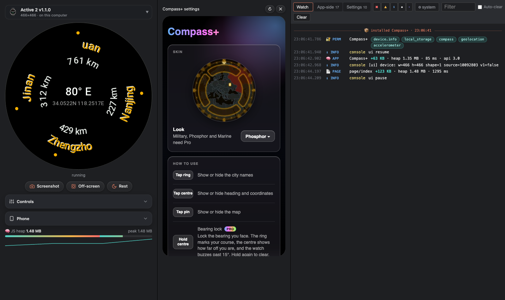
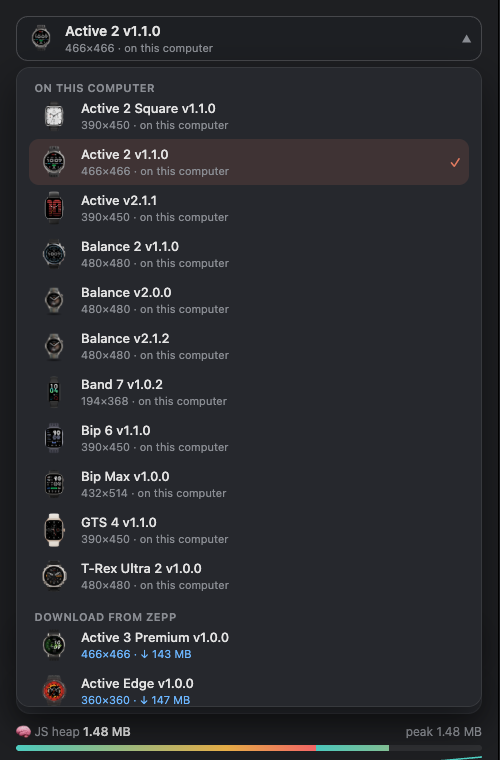
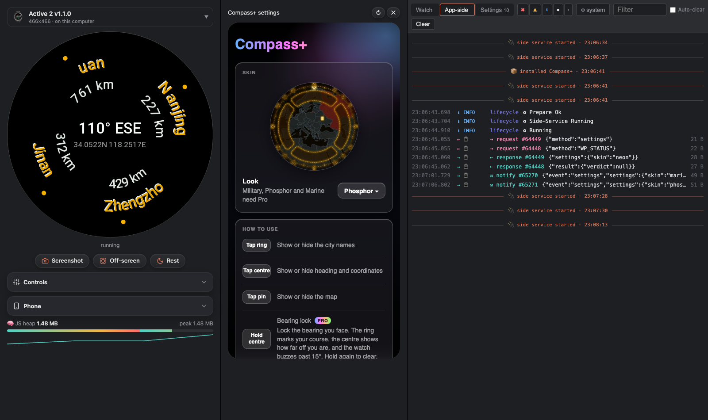
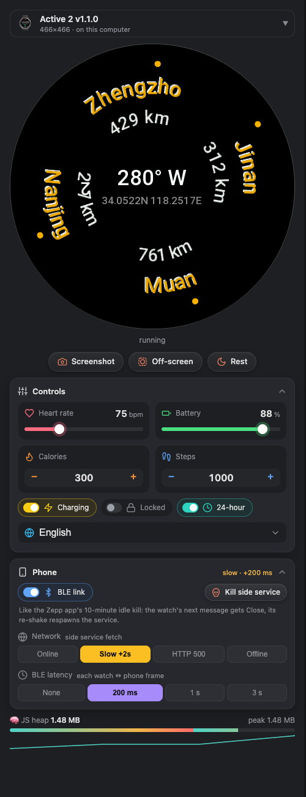
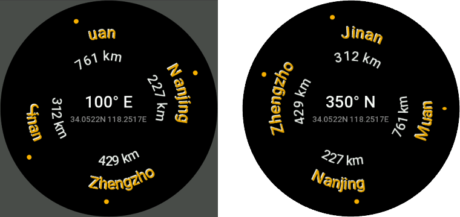

<div align="center">

# ⌚ simweb

**The ZeppOS simulator in a browser tab.**

Same firmware, same QEMU as the official Zepp Simulator — without the Electron app around it,
and with the debugging tools it never had.

[](LICENSE)
[](https://nodejs.org)
[](#-requirements)
[](https://docs.zepp.com)

[Quick start](#-quick-start) ·
[Features](#-features) ·
[Requirements](#-requirements) ·
[Usage](#-usage) ·
[How it works](#-how-it-works) ·
[Limits](#-limits)



</div>

## 🚀 Quick start

```sh
git clone https://github.com/activebridge/simweb.git
cd simweb && npm install
node bin/simweb.js     # boots the last watch you used, opens it in an app window
```

Then, in your app:

```sh
zeus dev               # works unchanged: simweb listens where the simulator did
```

## ✨ Highlights

|   |   |
|---|---|
| 📜 **Readable logs** | Watch, App-side and Settings tabs, app lines only, firmware noise one click away |
| 🔁 **Decoded messages** | every watch ↔ phone request, response and notify, as JSON |
| 🧠 **Memory** | heap gauge toward the next GC, load cost per app and page (`+148 KB · 478 ms`) |
| 💥 **Phone faults** | BLE link off, side service killed, network offline / slow / HTTP 500, BLE latency |
| ⌚ **Any watch** | every model in Zepp's catalog, switch in place, your last push reinstalled |
| 📸 **Store screenshots** | 360×360 PNGs clipped to the display, ready for the Zepp store |
| 📱 **Phone frame** | your settings page inside the Zepp app's own top bar, dark or light |

## 🤔 Why

The official simulator (v2.1.2) is a 289 MB Electron app whose window is a thin shell around
QEMU running the real watch firmware. simweb keeps the part that matters — QEMU plus the
firmware — and replaces the shell.

| | Zepp Simulator | simweb |
|---|---|---|
| UI | Electron window, fixed layout | browser tab, responsive; on small screens the watch, settings and logs snap-scroll |
| Switch watch | pick, wait, push again | picker with device images; reboots on the new firmware and **reinstalls your last push** |
| Firmware | download dialog | in the picker, with progress and **"update available"** for newer releases |
| Build for another watch | silently refuses (`inconsistent with the watch simulator model`) | installs it anyway |
| Console | one stream, ~2000 firmware lines per boot | Watch / App-side / Settings tabs, app lines only by default, ⚙ to see everything |
| App-side `console.log` | only in a devtools window | in the App-side tab |
| Watch ↔ phone messages | invisible | decoded per request/response/notify, JSON pretty-print on click |
| Memory | — | heap gauge + per app/page load cost (`+148 KB · 478 ms`) |
| Phone faults | — | BLE link off, kill side service (real Close / respawn path), offline / HTTP 500 / slow network, BLE latency |
| Screenshots | raw framebuffer | Zepp-store PNG: 360×360 RGBA, round or rounded-corner mask, transparent outside |
| Screen | square framebuffer with dimmed corners | masked to the real display shape (toggle to see off-screen drawing) |
| Flash | persistent, caches old assets | fresh copy every boot |

## 🧰 Features

### ⌚ Watch

- **Real firmware** in headless QEMU, streamed to the page over VNC. Click = tap, drag = swipe.
- **Display mask**: round watches are a circle, square-screen ones get rounded corners (21.8 % of
  the width, measured from Zepp's own masks). **Off-screen** shows what your app draws outside
  the display.
- **Controls**: heart rate, battery, calories, steps, charging, lock, 12/24 h, language (34).
  They reach the firmware the same way the Zepp simulator's panels do (watchfaces show the
  battery and charging state you set).
- **Rest** (screen off) and **Screenshot** (below).

### 🗂 Devices



- Every watch in Zepp's public catalog, newest release per model, with its image and resolution.
- Downloaded firmware lives in `~/.zepp/emulator_cache` — **shared with the Zepp simulator**.
- Switching reboots on the new firmware with a fresh flash and reinstalls the last app `zeus dev`
  pushed. The last watch is remembered for the next start.

### 📜 Logs



- **Three tabs**: Watch (firmware serial), App-side (side service), Settings (settings app).
  Unread counts per tab, red when an error arrived.
- Every line parsed into **time · level · tag · message**, colour per tag. Firmware and framework
  noise is hidden; **⚙ system** shows all of it, dimmed. Level chips and a text filter on top.
- **Decoded messages** between watch and phone: `⇢ request #2595 {"method":"PING"}`,
  `⇠ response`, `✉ notify`, `🤝` handshakes, chunked messages reassembled.
- **Insights** the firmware logs but nobody shows:
  - `🧠 APP  Crypto Portfolio  +148 KB · heap 1.15 MB · 478 ms · api 2.0`
  - `📄 PAGE page/home  +90 KB · heap 1.24 MB · 345 ms`
  - `🔐 PERM` the permissions your app actually uses, as pills
  - a **JS heap gauge** under the watch, filling toward the next GC, with a sparkline
- Repeated lines fold into `×N`; JS errors carry their stack; separators for boot, install,
  side-service start. **Auto-clear** empties the logs on every install.
- The installed build is unpacked to the run directory's `device/`, so a stack trace's line
  numbers can be read against the exact code the watch runs.

### 💥 Phone faults



Things the phone does to your app in real life, on demand:

| Fault | What happens |
|---|---|
| **BLE link off** | frames are dropped (`⚡ dropped: link down`), requests time out, link comes back on toggle |
| **Kill side service** | like the Zepp app's 10-minute idle kill: the watch's next message gets **Close**, its re-shake **respawns** the side service — your MessageBuilder's `onClose` path, for real |
| **Network** | the side service's `fetch` is Online, Slow (+2 s), HTTP 500 or Offline |
| **BLE latency** | 200 ms – 3 s added to each watch ↔ phone frame |

Active faults show in amber in the card header so you don't forget one.

### 📸 Store screenshots



**Screenshot** saves what the Zepp store wants: 360×360 RGBA, clipped to the display shape,
transparent outside, scaled to fit the height (a 390×450 screen becomes 312×360 at x=24).
Named `round-1-<app>.png` / `square-1-<app>.png`. **Shift+click** saves the raw framebuffer.

### 📱 Side service and settings

Zepp's own side-service and settings pages run in the tab (hidden iframe and a phone-size panel),
bridged to the watch, storage and the network the way the Electron app does it — but `fetch`
goes through simweb, so there is no CORS. `settingsStorage` persists in `~/.simweb/storage.json`.

- **Phone frame** over the settings page: the Android status bar and the Zepp app's title bar
  (back arrow, app name), as on the phone, so you see the room your page really gets.
  **◐ Dark / ○ Light / ▢ Off** from the button in the panel's header (or Phone → Settings frame);
  remembered across reloads.
- **↻** reloads the settings page, **✕** closes the panel (remembered); **Settings** under the
  watch brings it back freshly loaded, as reopening the settings app on the phone would.

## 📋 Requirements

- **Zepp Simulator installed** — simweb uses its QEMU binary (`/Applications/simulator.app` on
  macOS, `/opt/simulator` on Linux). You never have to open it.
- **Node 18+** and `unzip` (for firmware downloads).
- **Apple Silicon**: Zepp ships an x86-64 QEMU, so Rosetta must be installed.
- A Chromium browser (Chrome 135+ for the device picker with images; others get a plain select).
- Tested on macOS. Linux paths are in place but untested; Windows is not supported yet.

## 🛠 Usage

```sh
node bin/simweb.js                      # or: npm link, then just `simweb`
```

1. Quit the Zepp Simulator (both listen on 7650).
2. Start simweb, wait ~40 s for the watch to boot.
3. Run `zeus dev` in your app. Each save rebuilds and reinstalls in place.
4. For v1 apps, build for the watch you simulate: `zeus dev -t <target>` — without `-t`, zeus
   builds the **first** target in `app.json`.

> [!TIP]
> Keep **one** simweb tab open: the newest tab hosts the side service.

<details>
<summary><b>Options</b></summary>

| Option | |
|---|---|
| `--device "GTS 4"` | start on a downloaded watch (part of its name); default: the last one |
| `--port 7651` | page + zeus port (default 7650, the simulator's) |
| `--no-open` | don't open a window |
| `--tab` | open a normal browser tab instead of an app window |
| `--browser <bundle id or app>` | Chromium browser for the app window, e.g. `com.google.Chrome` (default: your default browser if it's Chromium, else the first installed) |
| `--qemu <path>` | use a specific `qemu-system-arm` |

</details>

## ⚙️ How it works

```
browser tab ─────────────── localhost:7650 (node helper) ─────────── qemu (headless, real firmware)
 ├ screen        ◄─ ws /vnc ───── VNC proxy ────────────────────────── -vnc
 ├ controls      ── HTTP ──────── Config / ScreenRest / ScreenShot ──► ws :7833 (firmware)
 ├ logs          ◄─ ws /serial ── parsed serial + bridge events ◄───── -serial stdio
 ├ side iframe   ── ws /bridge ── JSON-RPC router (storage, fetch) ──► ws :7833 "HMSDK" (BLE)
 └ settings      ── ws /bridge ─┘
zeus dev ── socket.io ──► install: device.zip ──► "Project install" + OpenProject
```

- The firmware serves its own control socket (port 7833 in the guest); everything the Electron
  panels do is a message on it.
- Zepp's hosted side-service and settings pages are loaded through localhost with a small shim
  (`public/shim.js`) that recreates the bridge objects Electron's preloads inject.
- `lib/bridge.js` is a port of Electron's main-process router, plus the phone-fault layer.

| Path | What |
|---|---|
| `bin/simweb.js` | the helper: QEMU, VNC proxy, zeus install, HTTP API |
| `lib/bridge.js` | the phone side: JSON-RPC router and fault layer |
| `public/` | the page, the log parser, the shim |
| `~/.simweb/` | state: controls, storage, last device |

## 🚧 Limits

- **JS sensors can't be set.** Geolocation (fixed 34.052, 118.252), accelerometer, gyroscope and
  compass come from a generator inside the firmware; barometer returns nothing. Same as the Zepp
  simulator.
- The settings app runs in desktop Chrome, not the phone's WebView (iOS zoom on small inputs,
  blocked downloads etc. won't reproduce).
- No Zepp developer-bridge (cloud relay) — local `zeus dev` only.
- Serial log lines are cut by the firmware at ~245 characters; split long `console.log` output.

## 📦 Firmware

The firmware images are Zepp's. simweb downloads them from Zepp's public CDN into your local cache
and runs them on your machine; it does not host or redistribute them.

## 📄 License

MIT © [Active Bridge](https://github.com/activebridge). The ZeppOS firmware and the simulator's
QEMU are Zepp's and are not covered by this license. simweb is an independent project, not
affiliated with or endorsed by Zepp Health.
